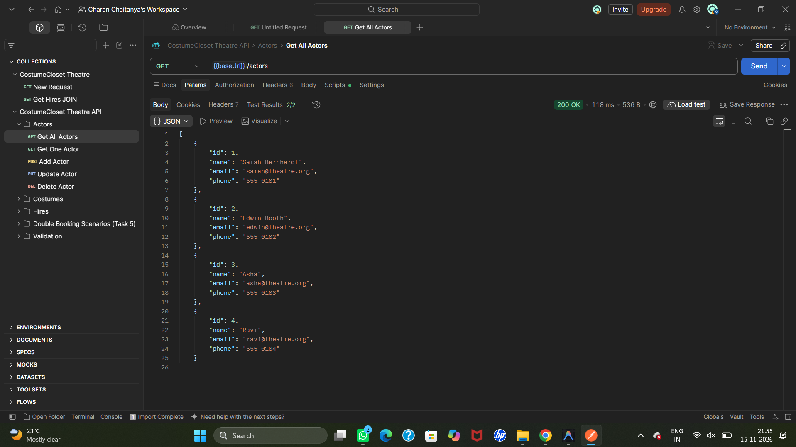
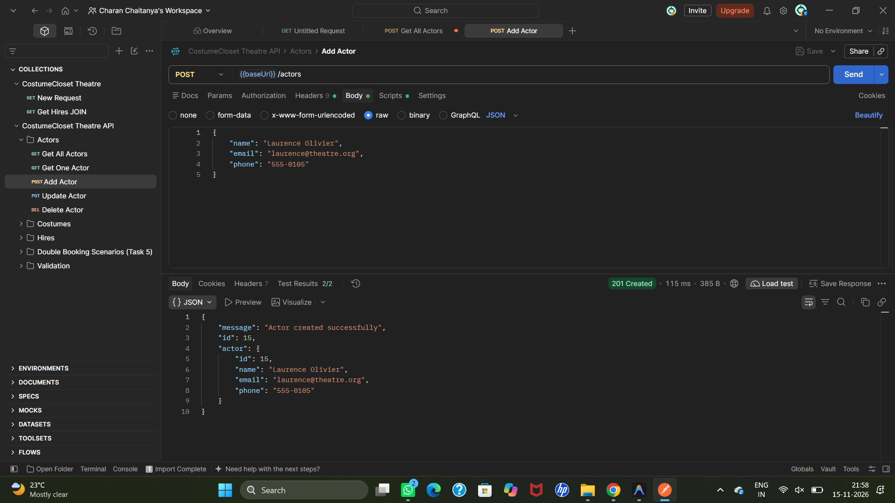
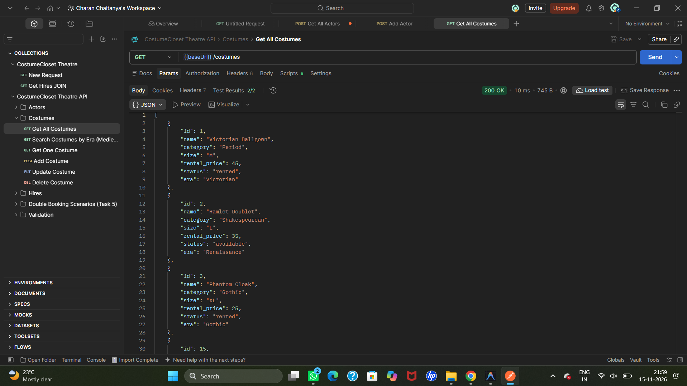
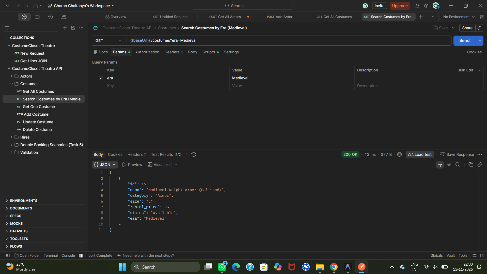
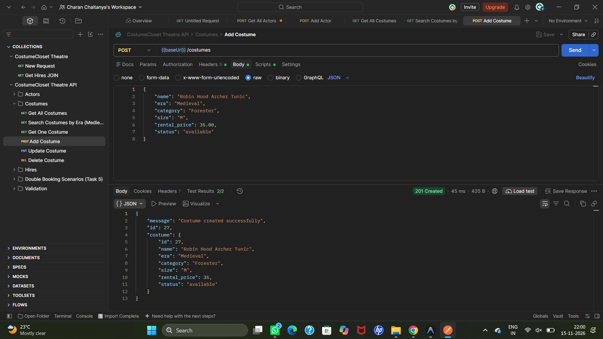
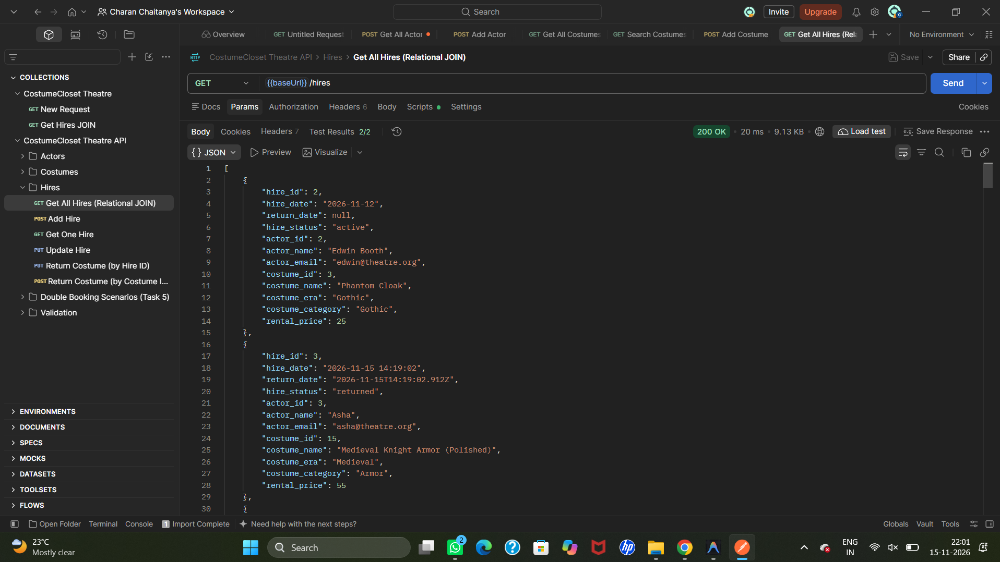
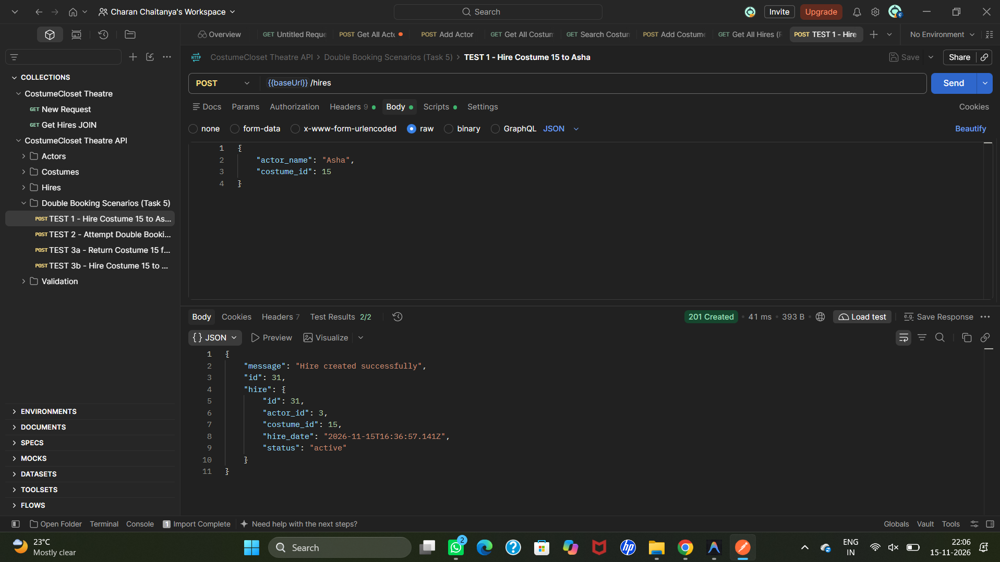
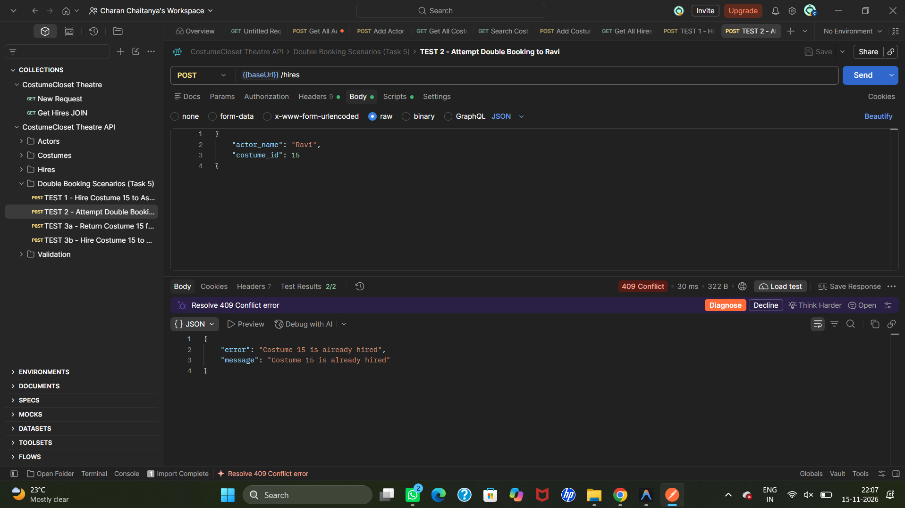
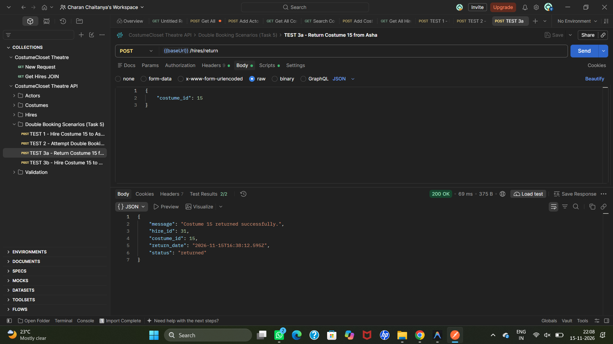
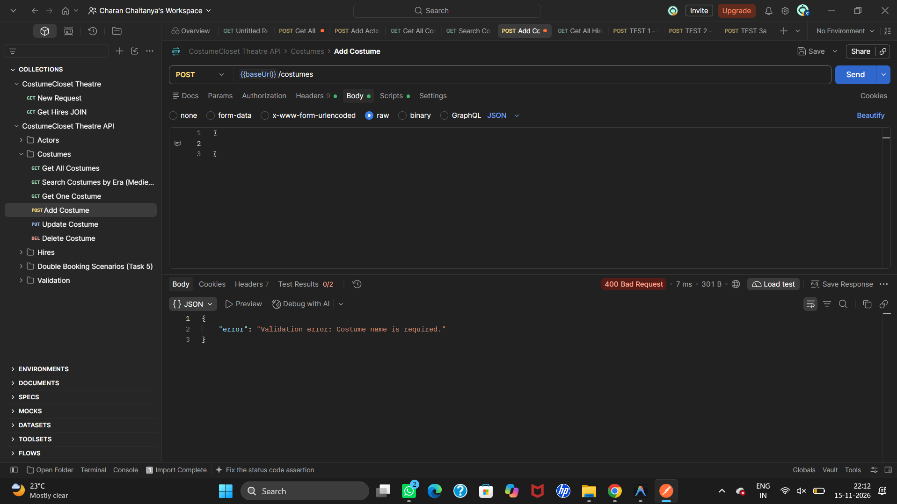

# CostumeCloset Theatre – Costume Hire Management System

A Node.js and Express REST API backed by SQLite for managing theatre actors, costume inventory, and costume hires. The system supports CRUD operations, costume search, joined hire information, input validation, and a no-double-booking rule.

## 1. Project Overview

The CostumeCloset Theatre backend helps theatre and wardrobe teams keep track of:

- Actor details.
- Costume inventory and historical eras.
- Active and returned costume hires.
- Which actor currently has a costume.
- Prevention of two actors hiring the same costume at the same time.

**Main assessment twist:** a costume that already has an active hire must not be hired to another actor. The API returns HTTP `409 Conflict` with the message `Costume <id> is already hired`.

## 2. Technologies

- **Runtime:** Node.js
- **Web framework:** Express.js
- **Database:** SQLite3
- **API format:** REST with JSON request and response bodies
- **API testing:** Postman collection and project test scripts

The dependencies and npm scripts are defined in `package.json`.

## 3. Project Structure

```text
backend group/
├── database.js
├── index.js
├── test.js
├── run_postman_collection.js
├── costume_closet.db
├── package.json
├── package-lock.json
├── CostumeCloset_Postman_Collection.json
├── .gitignore
├── README.md
└── Postman_Screenshots/
    ├── README.md
    ├── postman_execution_report.txt
    └── screenshots/
        ├── 01-get-actors.png.png
        ├── 02-add-actor.png.png
        ├── 03-get-costumes.png.png
        ├── 04-search-era.png.png
        ├── 05-add-costume.png.png
        ├── 06-join-hires.png.png
        ├── 07-booking-success.png.png
        ├── 08-double-booking-conflict.png.png
        ├── 09-return-and-rebook.png.png
        └── 10-validation-error.png.png
```

`node_modules/` is created locally by `npm install` and is excluded from Git using `.gitignore`.

## 4. Database Design

The SQLite database contains three related tables.

### `actors`

Stores actor information.

| Column | Description |
|---|---|
| `id` | Primary key |
| `name` | Actor name |
| `email` | Actor email |
| `phone` | Actor phone number |

### `costumes`

Stores the costume inventory.

| Column | Description |
|---|---|
| `id` | Primary key |
| `name` | Costume name |
| `era` | Historical era, such as Medieval or Victorian |
| `category` | Costume category |
| `size` | Costume size |
| `rental_price` | Rental price |
| `status` | Availability status, such as `available` or `rented` |

### `hires`

Stores costume hire records and links actors to costumes.

| Column | Description |
|---|---|
| `id` | Primary key |
| `actor_id` | Foreign key referencing `actors.id` |
| `costume_id` | Foreign key referencing `costumes.id` |
| `hire_date` | Hire date/time |
| `return_date` | Return date/time; empty while not returned |
| `status` | Hire status, such as `active` or `returned` |

The relationships allow the `/hires` endpoint to return hire details together with actor and costume names.

## 5. Running the Project

### Requirements

Install Node.js and npm. Then open a terminal in the project directory.

### Install dependencies

```bash
npm install
```

### Start the API server

```bash
npm start
```

The server uses port `3000` by default.

Base URL:

```text
http://localhost:3000
```

Keep the server terminal open while sending requests from Postman.

### Run the project test script

```bash
npm test
```

This runs `test.js`.

### Run the collection execution script

```bash
node run_postman_collection.js
```

This project script reads `CostumeCloset_Postman_Collection.json`, runs the collection requests against the Express application, evaluates the collection assertions, and writes a report to:

```text
Postman_Screenshots/postman_execution_report.txt
```

The saved report in this project records **22 requests and 40/40 assertions passed (0 failed)** for the run dated 15 November 2026. Run the script again to produce a fresh report for a new execution.

## 6. API Endpoints

All endpoints use the base URL `http://localhost:3000`. Request bodies should be sent as JSON where applicable.

### Root

| Method | Endpoint | Purpose |
|---|---|---|
| GET | `/` | API status and endpoint information |

### Actors

| Method | Endpoint | Purpose |
|---|---|---|
| GET | `/actors` | Get all actors; supports `?name=...` |
| GET | `/actors/:id` | Get one actor |
| POST | `/actors` | Add an actor |
| PUT | `/actors/:id` | Update an actor |
| DELETE | `/actors/:id` | Delete an actor |

Example — add an actor:

```http
POST /actors
Content-Type: application/json
```

```json
{
  "name": "Laurence Olivier",
  "email": "laurence@theatre.org",
  "phone": "555-0105"
}
```

### Costumes

| Method | Endpoint | Purpose |
|---|---|---|
| GET | `/costumes` | Get all costumes |
| GET | `/costumes/:id` | Get one costume |
| POST | `/costumes` | Add a costume |
| PUT | `/costumes/:id` | Update a costume |
| DELETE | `/costumes/:id` | Delete a costume |

The `GET /costumes` endpoint supports these query parameters:

- `era`
- `category`
- `status`
- `name`

Example — search by era:

```http
GET /costumes?era=Medieval
```

Example — add a costume:

```http
POST /costumes
Content-Type: application/json
```

```json
{
  "name": "Robin Hood Archer Tunic",
  "era": "Medieval",
  "category": "Forester",
  "size": "M",
  "rental_price": 35
}
```

### Hires

| Method | Endpoint | Purpose |
|---|---|---|
| GET | `/hires` | Get hires with actor and costume details using JOIN |
| GET | `/hires/:id` | Get one hire with joined details |
| POST | `/hires` | Create a hire |
| PUT | `/hires/:id` | Update a hire |
| PUT | `/hires/:id/return` | Return a costume using the hire ID |
| POST | `/hires/return` | Return an active hire using `costume_id` |
| DELETE | `/hires/:id` | Delete a hire |

The `GET /hires` endpoint supports optional filters such as `status`, `actor_id`, and `costume_id`.

Example — create a hire:

```http
POST /hires
Content-Type: application/json
```

```json
{
  "actor_id": 3,
  "costume_id": 15
}
```

Example — return a costume by costume ID:

```http
POST /hires/return
Content-Type: application/json
```

```json
{
  "costume_id": 15
}
```

## 7. No-Double-Booking Rule (Assessment Twist)

A costume must not have more than one active hire at a time.

The required demonstration uses Costume ID `15`:

| Test | Action | Expected result |
|---|---|---|
| Test 1 | Asha hires Costume 15 | `201 Created` |
| Test 2 | Ravi tries to hire Costume 15 while Asha still has it | `409 Conflict` |
| Test 3 | Return Costume 15, then Ravi hires it | `201 Created` |

For the conflict case, the API response includes:

```json
{
  "error": "Costume 15 is already hired",
  "message": "Costume 15 is already hired"
}
```

The hire logic checks for an existing active hire and uses an SQLite `BEGIN IMMEDIATE` transaction with a second availability check before inserting a new hire and updating the costume status. Returning a costume changes the hire status to `returned` and makes the costume available again.

## 8. Validation and HTTP Status Codes

The API validates required input before creating records.

Examples:

- Actor name is required and cannot be blank.
- Costume name is required and cannot be blank.
- Costume era is required and cannot be blank.
- A hire must include a valid actor reference and costume ID.
- The referenced actor and costume must exist.
- Unknown routes return `404 Not Found`.

Common status codes:

| Status | Meaning |
|---|---|
| `200 OK` | Request completed successfully |
| `201 Created` | A record or hire was created |
| `400 Bad Request` | Required input is missing or invalid |
| `404 Not Found` | Requested record or route was not found |
| `409 Conflict` | Costume is already actively hired |
| `500 Internal Server Error` | Unexpected server or database error |

## 9. Postman Collection

The Postman collection is:

```text
CostumeCloset_Postman_Collection.json
```

To use it:

1. Start the server with `npm start`.
2. Open Postman.
3. Select **Import**.
4. Choose `CostumeCloset_Postman_Collection.json`.
5. Check that the collection's `baseUrl` variable is `http://localhost:3000`.
6. Send requests individually or use the Postman Collection Runner.
7. Review the response status, response body, and test results.

The collection is organized into Actors, Costumes, Hires, Double Booking Scenarios, and Validation requests.

## 10. Postman Screenshot Evidence

The actual Postman screenshots are stored in `Postman_Screenshots/screenshots/`. They show the request method, endpoint, response status, and response body.

> Note: The image filenames currently have a repeated `.png` suffix (for example, `01-get-actors.png.png`). The links below use the filenames as they currently exist in the project.

### 1. Get all actors — 200 OK



### 2. Add actor — 201 Created



### 3. Get all costumes — 200 OK



### 4. Search costumes by era — 200 OK



### 5. Add costume — 201 Created



### 6. Get hires with actor and costume details — 200 OK



### 7. Successful booking of Costume 15 — 201 Created



### 8. Duplicate booking rejected — 409 Conflict



### 9. Return Costume 15 — 200 OK



This screenshot shows the return response. The subsequent successful rebooking of Costume 15 to Ravi is recorded in the collection execution report.

### 10. Validation error — 400 Bad Request



## 11. Test and Evidence Report

The saved collection execution report is located at:

```text
Postman_Screenshots/postman_execution_report.txt
```

It records:

- Total requests: **22**
- Assertions passed: **40**
- Assertions failed: **0**
- Successful booking test: HTTP `201`
- Duplicate booking test: HTTP `409`
- Return test: HTTP `200`
- Rebooking after return: HTTP `201`
- Missing costume era validation: HTTP `400`

The report is evidence from the saved run. Execute the test scripts again before a new demonstration to confirm the current code and database state.

## 12. GitHub Submission

Before committing, check that `.gitignore` excludes `node_modules/`, `.env` files, log files, and ZIP archives.

Typical Git commands:

```bash
git add .
git status
git commit -m "Complete CostumeCloset Theatre Backend Assessment"
git push -u origin main
```

Keep the database file, source code, Postman collection, README, test scripts, execution report, and screenshot evidence in the repository.

---

**Project:** CostumeCloset Theatre – Costume Hire Management System  
**Backend:** Node.js, Express.js, SQLite  
**API base URL:** `http://localhost:3000`
